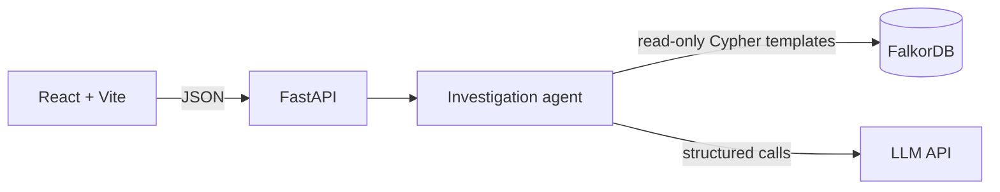

# GraphPilot — API Contract

> Companion to `GraphPilot_MVP_Scope.md`, `GraphPilot_Graph_Schema.md` and `GraphPilot_Core_Demo_Scenario.md`. This document defines the HTTP interface between the React frontend, the FastAPI backend, the investigation agent, and FalkorDB.

**Status:** Planning · **Format:** JSON over HTTP · **Examples use the primary demo scenario** (as of 2026-10-15). Example values are illustrative of the seeded data; the backend must populate every field from retrieved records and computed results, never from fixed text.

---

## 1. Purpose and Architecture



The frontend never talks to FalkorDB or the LLM directly. The agent follows the principle from the scope document: **Cypher retrieves, Python computes, the LLM explains.** Pydantic models in the backend are the executable source of truth; FastAPI's generated OpenAPI docs must match this document.

---

## 2. Conventions

| Topic | Rule |
|---|---|
| Format | JSON request and response bodies, UTF-8 |
| Dates | ISO-8601 strings (`YYYY-MM-DD`) |
| Entity IDs | Human-readable, globally unique by prefix: `SUP-`, `PRD-`, `PO-`, `WH-`, `BR-`, `SNP-`, `SAL-`, `MOV-`. The entity endpoint relies on these prefixes (see §6) |
| Risk levels | `AT_RISK`, `WATCH`, `OK`, `UNKNOWN` (same as the scope document) |
| Arrays | Always present in a response, empty when there is nothing to report. Objects may be `null` |
| As-of date | Set by backend configuration and returned as `as_of_date`. Clients cannot override it |
| State | Each `POST /api/chat` call is **stateless**. A follow-up must name its entities explicitly (e.g. "Why is PRD-101 at risk at BR-02?") |
| Execution | Synchronous. The primary demo question targets about 30 seconds or less. Streaming is out of scope |
| Development | Vite dev server proxies `/api` and `/health` to FastAPI; CORS allows only the dev origin |
| Versioning | None for the MVP |

---

## 3. Endpoint Summary

| Method | Path | Priority | Purpose |
|---|---|---|---|
| `GET` | `/health` | P0 | Backend and dependency status |
| `POST` | `/api/chat` | P0 | Submit a question, receive a full investigation |
| `GET` | `/api/graph/entity/{entity_id}` | P1 | Inspect one entity and its connections (graph-view click-through) |
| `GET` | `/api/investigations/{investigation_id}` | P2 | Retrieve a stored investigation (only if persisted) |
| `GET` | `/api/investigations` | P2 | List stored investigations (history sidebar) |

Graph seeding is a CLI script, not an endpoint, so no write path to the graph is exposed.

---

## 4. `GET /health`

**Purpose:** Check that the backend is running, that FalkorDB is reachable and seeded, and whether the LLM is configured. The check never calls the LLM (no cost, no latency).

**Response `200`**

```json
{
  "status": "ok",
  "service": "graphpilot",
  "as_of_date": "2026-10-15",
  "dependencies": {
    "falkordb": "ok",
    "graph_seeded": true,
    "llm": "configured"
  }
}
```

| Field | Values |
|---|---|
| `status` | `ok`, `degraded` (LLM not configured; investigations still work using the deterministic fallback) |
| `dependencies.falkordb` | `ok`, `unavailable` |
| `dependencies.graph_seeded` | `true` when the expected labels (e.g. `PurchaseOrder`) contain data |
| `dependencies.llm` | `configured`, `not_configured` |

**Response `503`** (FalkorDB unreachable) uses the standard error envelope with code `GRAPH_UNAVAILABLE` (§8).

---

## 5. `POST /api/chat`

**Purpose:** Submit a natural-language investigation question and receive the complete result: answer, root cause, labelled findings, evidence, graph, and recommendations.

### 5.1 Request

```json
{
  "question": "A supplier disruption has occurred. Which products and branches are most at risk because of it, how will the disruption propagate through our supply chain, what evidence supports the root cause, and what is the best recovery action?"
}
```

| Field | Type | Rules |
|---|---|---|
| `question` | string | Required. Trimmed. 1–500 characters. Plain text |

### 5.2 Outcomes (`status`)

Business outcomes are returned as `200` with a `status` value. They are valid results, not HTTP errors.

| `status` | Meaning | Notable fields |
|---|---|---|
| `completed` | Investigation finished with sufficient evidence | All fields populated |
| `needs_clarification` | An entity name is ambiguous or not found | `clarification` |
| `insufficient_evidence` | Entities were resolved but data is too thin to estimate (e.g. no sales history) | Partial findings, `risk_level: UNKNOWN`, `limitations` |
| `unsupported_question` | Outside the two supported intents | `supported_examples` |

### 5.3 Response fields

| Field | Type | Description |
|---|---|---|
| `investigation_id` | string | Unique ID, e.g. `inv-3f9a2c1b` |
| `status` | enum | See §5.2 |
| `intent` | enum \| null | `disruption_impact` or `risk_root_cause` |
| `question` | string | Echo of the request |
| `as_of_date` | date | Reference date used for all calculations |
| `explanation_mode` | enum | `llm`, or `deterministic_fallback` when the LLM was unavailable or its output failed validation |
| `risk_level` | enum \| null | Highest risk among `affected_entities` |
| `answer` | string | Narrative answer for the chat panel |
| `root_cause` | object \| null | `statement`, `support_level` (`supported`, `partially_supported`, `insufficient_evidence`), `supporting_finding_ids` |
| `verified_facts` | array | Findings read directly from retrieved records. Each has `finding_id` (`F#`), `statement`, `evidence_ids`, optional `edge_ids` |
| `calculated_estimates` | array | Deterministic results. Each has `finding_id` (`C#`), `statement`, `formula`, `inputs`, `evidence_ids`, `assumption_ids` |
| `assumptions` | array | `assumption_id` (`A#`), `statement` |
| `affected_entities` | array | Structurally exposed entities: `entity_type`, `entity_id`, `name`, `role`, `risk_level`, optional `rank`, `estimated_unmet_units` |
| `not_exposed_entities` | array | Entities examined and cleared because no path links them to the disruption: `entity_type`, `entity_id`, `name`, `reason` |
| `graph` | object | `nodes` and `edges` for the graph view (§5.5) |
| `evidence_paths` | array | Named paths over `graph.edges`: `path_id`, `description`, `edge_ids` |
| `evidence` | array | Raw records behind the findings (§5.6) |
| `recommendations` | array | Ranked actions (§5.7) |
| `data_quality_issues` | array | `issue_id`, `type` (`MISSING` or `CONTRADICTION`), `statement`, `evidence_ids`, `impact_on_conclusion` |
| `limitations` | array of strings | Plain-language limits of the conclusion |
| `queries_executed` | array | `query_id`, `template`, `params`, `row_count`, `read_only` |
| `clarification` | object \| null | `reason`, `options` (each with `entity_type`, `entity_id`, `label`) |
| `supported_examples` | array of strings | Example questions, for `unsupported_question` |

**`affected_entities.role` values:** `disruption_source`, `delayed_order`, `at_risk_product`, `at_risk_location`, `at_risk_branch`, `exposed_not_at_risk`.

**Evidence labels.** Every statement appears in exactly one of: `verified_facts` (observed), `calculated_estimates` (formula over facts plus assumptions), `assumptions` (not in the data), or `recommendations` (proposed actions). The `answer` text may blend them for readability, but each sentence must be traceable to a finding ID.

### 5.4 Example: `completed` response (primary demo)

<details>
<summary>Show full JSON</summary>

```json
{
  "investigation_id": "inv-3f9a2c1b",
  "status": "completed",
  "intent": "disruption_impact",
  "question": "A supplier disruption has occurred. Which products and branches are most at risk because of it, how will the disruption propagate through our supply chain, what evidence supports the root cause, and what is the best recovery action?",
  "as_of_date": "2026-10-15",
  "explanation_mode": "llm",
  "risk_level": "AT_RISK",
  "answer": "PO-1042 from Apex Components (SUP-003) is confirmed delayed by 14 days (revised ETA 2026-10-26); the reason for the delay is not recorded. WH-01 is projected to run out of PRD-101 on 2026-10-22, putting BR-01 (about 75 units short) and BR-02 (about 20 units short) at risk. BR-02 is above its reorder level, so a stock-level dashboard would not flag it. PRD-102 shares the order but is not at risk, and BR-04 and BR-05 are not exposed. The recommended action is to transfer 95 units from WH-02, which keeps about 26.8 days of cover. One record conflict on PRD-102 is noted below; it does not change this conclusion.",
  "root_cause": {
    "statement": "The confirmed 14-day delay of PO-1042 (SUP-003) is the supported driver of the projected PRD-101 shortfall at BR-01 and BR-02. The reason for the supplier delay is not recorded.",
    "support_level": "supported",
    "supporting_finding_ids": ["F1", "F2", "F3", "C1", "C3", "C4"]
  },
  "verified_facts": [
    { "finding_id": "F1", "statement": "PO-1042, placed with SUP-003, is open with original expected date 2026-10-12 and revised expected date 2026-10-26. No delay reason is recorded.", "evidence_ids": ["E1"], "edge_ids": ["e1"] },
    { "finding_id": "F2", "statement": "PO-1042 contains PRD-101 (ordered 800, received 0) and PRD-102 (ordered 600, received 0), and delivers to WH-01.", "evidence_ids": ["E2", "E3"], "edge_ids": ["e2", "e3", "e4"] },
    { "finding_id": "F3", "statement": "WH-01 holds 420 units of PRD-101 as of 2026-10-15 and replenishes BR-01, BR-02 and BR-03.", "evidence_ids": ["E4"], "edge_ids": ["e5", "e6", "e7"] },
    { "finding_id": "F4", "statement": "Branch stock of PRD-101 as of 2026-10-15: BR-01 25, BR-02 60, BR-03 150.", "evidence_ids": ["E5", "E6", "E7"], "edge_ids": [] },
    { "finding_id": "F5", "statement": "Reorder levels for PRD-101: BR-01 50, BR-02 40, BR-03 30. Only BR-01 is below its reorder level.", "evidence_ids": ["E8", "E9", "E10"], "edge_ids": ["e8", "e9", "e10"] },
    { "finding_id": "F6", "statement": "No other open purchase order delivering PRD-101 to WH-01 was found in the dataset.", "evidence_ids": ["E12"], "edge_ids": [] },
    { "finding_id": "F7", "statement": "WH-02 holds 900 units of PRD-101 as of 2026-10-15.", "evidence_ids": ["E13"], "edge_ids": [] },
    { "finding_id": "F8", "statement": "SUP-005 also supplies PRD-101, with a typical lead time of 9 days.", "evidence_ids": ["E15"], "edge_ids": ["e11"] },
    { "finding_id": "F9", "statement": "BR-04 and BR-05 carry PRD-101 but are replenished by WH-02. No relationship path links them to PO-1042.", "evidence_ids": ["E17"], "edge_ids": ["e12", "e13", "e14", "e15"] }
  ],
  "calculated_estimates": [
    { "finding_id": "C1", "statement": "PO-1042's revised date is 14 days after its original date. At 2026-10-15 it is already 3 days past the original date.", "formula": "revised_expected_date - expected_date = 2026-10-26 - 2026-10-12", "inputs": { "revised_expected_date": "2026-10-26", "expected_date": "2026-10-12" }, "evidence_ids": ["E1"], "assumption_ids": [] },
    { "finding_id": "C2", "statement": "Trailing 28-day demand for PRD-101 across WH-01's branches is 60 units/day (BR-01 25, BR-02 20, BR-03 15).", "formula": "sum(quantity over 28 days) / 28 per branch", "inputs": { "BR-01": 25, "BR-02": 20, "BR-03": 15 }, "evidence_ids": ["E11"], "assumption_ids": ["A1"] },
    { "finding_id": "C3", "statement": "WH-01 has about 7.0 days of PRD-101 cover, so replenishment of its branches is projected to stop on 2026-10-22, 4 days before the revised ETA.", "formula": "420 / 60 = 7.0 days; 2026-10-15 + 7 days", "inputs": { "stock_on_hand": 420, "daily_demand": 60 }, "evidence_ids": ["E4", "E11"], "assumption_ids": ["A1"] },
    { "finding_id": "C4", "statement": "BR-01 is projected to run out on 2026-10-23 (3 days before the ETA, about 75 units short). BR-02 is projected to run out on 2026-10-25 (1 day before, about 20 units short). BR-03 is projected to run out on 2026-11-01, after the ETA.", "formula": "branch_stockout = warehouse_stockout + branch_stock / branch_demand; unmet_units = max(0, ETA - branch_stockout) x branch_demand", "inputs": { "BR-01": { "own_cover_days": 1.0, "stockout_date": "2026-10-23", "exposure_days": 3, "unmet_units": 75 }, "BR-02": { "own_cover_days": 3.0, "stockout_date": "2026-10-25", "exposure_days": 1, "unmet_units": 20 }, "BR-03": { "own_cover_days": 10.0, "stockout_date": "2026-11-01", "exposure_days": 0, "unmet_units": 0 } }, "evidence_ids": ["E5", "E6", "E7", "E11"], "assumption_ids": ["A1", "A5", "A6"] },
    { "finding_id": "C5", "statement": "PRD-102 at WH-01 has about 25.0 days of cover (stockout 2026-11-09), and every branch stockout falls in November, after the ETA. It is not at risk.", "formula": "300 / 12 = 25.0 days; 2026-10-15 + 25 days", "inputs": { "stock_on_hand": 300, "daily_demand": 12 }, "evidence_ids": ["E16"], "assumption_ids": ["A1", "A5", "A6"] },
    { "finding_id": "C6", "statement": "WH-02 holds about 480 units of PRD-101 above 14 days of its own cover.", "formula": "900 - (30 x 14) = 480", "inputs": { "stock_on_hand": 900, "daily_demand": 30, "safety_days": 14 }, "evidence_ids": ["E13", "E14"], "assumption_ids": ["A1", "A2"] },
    { "finding_id": "C7", "statement": "An order placed with SUP-005 on 2026-10-15 would arrive about 2026-10-24, cutting BR-01 exposure to 1 day (about 25 units) and BR-02 exposure to 0, leaving about 25 units unmet.", "formula": "2026-10-15 + 9 days = 2026-10-24", "inputs": { "lead_time_days": 9 }, "evidence_ids": ["E15"], "assumption_ids": ["A4", "A6"] }
  ],
  "assumptions": [
    { "assumption_id": "A1", "statement": "Demand continues at the trailing 28-day average." },
    { "assumption_id": "A2", "statement": "A donor location keeps 14 days of its own cover." },
    { "assumption_id": "A3", "statement": "A transfer takes 2 days (not in data)." },
    { "assumption_id": "A4", "statement": "The alternate supplier's typical lead time holds and capacity is available (not in data)." },
    { "assumption_id": "A5", "statement": "Branches are replenished from the warehouse until it runs out; branch stock is not drawn down in the meantime." },
    { "assumption_id": "A6", "statement": "The ETA is treated as the date stock reaches branches; warehouse-to-branch transit is ignored." },
    { "assumption_id": "A7", "statement": "The donor warehouse can dispatch directly to the receiving branches (the lane is not modelled in the graph)." }
  ],
  "affected_entities": [
    { "entity_type": "Supplier", "entity_id": "SUP-003", "name": "Apex Components Ltd", "role": "disruption_source", "risk_level": null },
    { "entity_type": "PurchaseOrder", "entity_id": "PO-1042", "name": "PO-1042", "role": "delayed_order", "risk_level": null },
    { "entity_type": "Product", "entity_id": "PRD-101", "name": "USB-C Fast Charger 65W", "role": "at_risk_product", "risk_level": "AT_RISK", "estimated_unmet_units": 95 },
    { "entity_type": "Warehouse", "entity_id": "WH-01", "name": "North Warehouse", "role": "at_risk_location", "risk_level": "AT_RISK" },
    { "entity_type": "Branch", "entity_id": "BR-01", "name": "North Branch 1", "role": "at_risk_branch", "risk_level": "AT_RISK", "rank": 1, "estimated_unmet_units": 75 },
    { "entity_type": "Branch", "entity_id": "BR-02", "name": "North Branch 2", "role": "at_risk_branch", "risk_level": "AT_RISK", "rank": 2, "estimated_unmet_units": 20 },
    { "entity_type": "Branch", "entity_id": "BR-03", "name": "North Branch 3", "role": "exposed_not_at_risk", "risk_level": "OK", "estimated_unmet_units": 0 },
    { "entity_type": "Product", "entity_id": "PRD-102", "name": "Wireless Earbuds", "role": "exposed_not_at_risk", "risk_level": "OK", "estimated_unmet_units": 0 }
  ],
  "not_exposed_entities": [
    { "entity_type": "Branch", "entity_id": "BR-04", "name": "South Branch 1", "reason": "Replenished by WH-02; no path to PO-1042." },
    { "entity_type": "Branch", "entity_id": "BR-05", "name": "South Branch 2", "reason": "Replenished by WH-02; no path to PO-1042." }
  ],
  "graph": {
    "nodes": [
      { "entity_id": "SUP-003", "entity_type": "Supplier", "label": "Apex Components Ltd", "risk_level": null },
      { "entity_id": "PO-1042", "entity_type": "PurchaseOrder", "label": "PO-1042", "risk_level": null },
      { "entity_id": "PRD-101", "entity_type": "Product", "label": "USB-C Fast Charger 65W", "risk_level": "AT_RISK" },
      { "entity_id": "PRD-102", "entity_type": "Product", "label": "Wireless Earbuds", "risk_level": "OK" },
      { "entity_id": "WH-01", "entity_type": "Warehouse", "label": "North Warehouse", "risk_level": "AT_RISK" },
      { "entity_id": "BR-01", "entity_type": "Branch", "label": "North Branch 1", "risk_level": "AT_RISK" },
      { "entity_id": "BR-02", "entity_type": "Branch", "label": "North Branch 2", "risk_level": "AT_RISK" },
      { "entity_id": "BR-03", "entity_type": "Branch", "label": "North Branch 3", "risk_level": "OK" },
      { "entity_id": "SUP-005", "entity_type": "Supplier", "label": "SUP-005", "risk_level": null },
      { "entity_id": "WH-02", "entity_type": "Warehouse", "label": "South Warehouse", "risk_level": null },
      { "entity_id": "BR-04", "entity_type": "Branch", "label": "South Branch 1", "risk_level": null },
      { "entity_id": "BR-05", "entity_type": "Branch", "label": "South Branch 2", "risk_level": null }
    ],
    "edges": [
      { "edge_id": "e1", "from": "SUP-003", "relationship": "HAS_ORDER", "to": "PO-1042" },
      { "edge_id": "e2", "from": "PO-1042", "relationship": "CONTAINS", "to": "PRD-101", "properties": { "ordered_qty": 800, "received_qty": 0 } },
      { "edge_id": "e3", "from": "PO-1042", "relationship": "CONTAINS", "to": "PRD-102", "properties": { "ordered_qty": 600, "received_qty": 0 } },
      { "edge_id": "e4", "from": "PO-1042", "relationship": "DELIVERS_TO", "to": "WH-01" },
      { "edge_id": "e5", "from": "WH-01", "relationship": "REPLENISHES", "to": "BR-01" },
      { "edge_id": "e6", "from": "WH-01", "relationship": "REPLENISHES", "to": "BR-02" },
      { "edge_id": "e7", "from": "WH-01", "relationship": "REPLENISHES", "to": "BR-03" },
      { "edge_id": "e8", "from": "BR-01", "relationship": "STOCKS", "to": "PRD-101", "properties": { "reorder_level": 50 } },
      { "edge_id": "e9", "from": "BR-02", "relationship": "STOCKS", "to": "PRD-101", "properties": { "reorder_level": 40 } },
      { "edge_id": "e10", "from": "BR-03", "relationship": "STOCKS", "to": "PRD-101", "properties": { "reorder_level": 30 } },
      { "edge_id": "e11", "from": "SUP-005", "relationship": "SUPPLIES", "to": "PRD-101" },
      { "edge_id": "e12", "from": "WH-02", "relationship": "REPLENISHES", "to": "BR-04" },
      { "edge_id": "e13", "from": "WH-02", "relationship": "REPLENISHES", "to": "BR-05" },
      { "edge_id": "e14", "from": "BR-04", "relationship": "STOCKS", "to": "PRD-101" },
      { "edge_id": "e15", "from": "BR-05", "relationship": "STOCKS", "to": "PRD-101" }
    ]
  },
  "evidence_paths": [
    { "path_id": "P1", "description": "Disruption propagation: supplier to at-risk branches for PRD-101", "edge_ids": ["e1", "e2", "e4", "e5", "e6", "e7", "e8", "e9", "e10"] },
    { "path_id": "P2", "description": "Other product on the same order (checked, not at risk)", "edge_ids": ["e3"] },
    { "path_id": "P3", "description": "Alternate supplier for PRD-101", "edge_ids": ["e11"] },
    { "path_id": "P4", "description": "Branches carrying PRD-101 outside the disruption path", "edge_ids": ["e12", "e13", "e14", "e15"] }
  ],
  "evidence": [
    { "evidence_id": "E1", "kind": "record", "record_type": "PurchaseOrder", "record_id": "PO-1042", "properties": { "status": "open", "order_date": "2026-09-20", "expected_date": "2026-10-12", "revised_expected_date": "2026-10-26", "actual_delivery_date": null, "delay_reason": null }, "query_id": "Q1" },
    { "evidence_id": "E2", "kind": "relationship", "record_type": "CONTAINS", "record_id": "PO-1042|CONTAINS|PRD-101", "properties": { "ordered_qty": 800, "received_qty": 0 }, "query_id": "Q1" },
    { "evidence_id": "E3", "kind": "relationship", "record_type": "CONTAINS", "record_id": "PO-1042|CONTAINS|PRD-102", "properties": { "ordered_qty": 600, "received_qty": 0 }, "query_id": "Q1" },
    { "evidence_id": "E4", "kind": "record", "record_type": "InventorySnapshot", "record_id": "SNP-WH01-PRD101-20261015", "properties": { "snapshot_date": "2026-10-15", "stock_on_hand": 420 }, "query_id": "Q3" },
    { "evidence_id": "E5", "kind": "record", "record_type": "InventorySnapshot", "record_id": "SNP-BR01-PRD101-20261015", "properties": { "snapshot_date": "2026-10-15", "stock_on_hand": 25 }, "query_id": "Q3" },
    { "evidence_id": "E6", "kind": "record", "record_type": "InventorySnapshot", "record_id": "SNP-BR02-PRD101-20261015", "properties": { "snapshot_date": "2026-10-15", "stock_on_hand": 60 }, "query_id": "Q3" },
    { "evidence_id": "E7", "kind": "record", "record_type": "InventorySnapshot", "record_id": "SNP-BR03-PRD101-20261015", "properties": { "snapshot_date": "2026-10-15", "stock_on_hand": 150 }, "query_id": "Q3" },
    { "evidence_id": "E8", "kind": "relationship", "record_type": "STOCKS", "record_id": "BR-01|STOCKS|PRD-101", "properties": { "reorder_level": 50 }, "query_id": "Q2" },
    { "evidence_id": "E9", "kind": "relationship", "record_type": "STOCKS", "record_id": "BR-02|STOCKS|PRD-101", "properties": { "reorder_level": 40 }, "query_id": "Q2" },
    { "evidence_id": "E10", "kind": "relationship", "record_type": "STOCKS", "record_id": "BR-03|STOCKS|PRD-101", "properties": { "reorder_level": 30 }, "query_id": "Q2" },
    { "evidence_id": "E11", "kind": "aggregate", "record_type": "Sale", "record_id": null, "description": "Trailing 28-day average daily sales of PRD-101 per branch served by WH-01", "record_count": 84, "values": { "BR-01": 25, "BR-02": 20, "BR-03": 15 }, "query_id": "Q4" },
    { "evidence_id": "E12", "kind": "aggregate", "record_type": "PurchaseOrder", "record_id": null, "description": "Other open purchase orders delivering PRD-101 to WH-01", "record_count": 0, "values": {}, "query_id": "Q5" },
    { "evidence_id": "E13", "kind": "record", "record_type": "InventorySnapshot", "record_id": "SNP-WH02-PRD101-20261015", "properties": { "snapshot_date": "2026-10-15", "stock_on_hand": 900 }, "query_id": "Q6" },
    { "evidence_id": "E14", "kind": "aggregate", "record_type": "Sale", "record_id": null, "description": "Trailing 28-day average daily sales of PRD-101 per branch served by WH-02", "record_count": 56, "values": { "BR-04": 18, "BR-05": 12 }, "query_id": "Q6" },
    { "evidence_id": "E15", "kind": "record", "record_type": "Supplier", "record_id": "SUP-005", "properties": { "lead_time_days": 9 }, "query_id": "Q7" },
    { "evidence_id": "E16", "kind": "aggregate", "record_type": "InventorySnapshot", "record_id": null, "description": "PRD-102 position at WH-01 and its branches: stock 300 at WH-01; branch stock BR-01 60, BR-02 40, BR-03 30; demand 5, 4, 3 units/day", "record_count": 88, "values": { "warehouse_stock": 300, "warehouse_daily_demand": 12 }, "query_id": "Q4" },
    { "evidence_id": "E17", "kind": "aggregate", "record_type": "Branch", "record_id": null, "description": "Branches reachable downstream of PO-1042", "record_count": 3, "values": { "branches": ["BR-01", "BR-02", "BR-03"] }, "query_id": "Q2" },
    { "evidence_id": "E18", "kind": "record", "record_type": "StockMovement", "record_id": "MOV-0007", "properties": { "movement_type": "receipt", "movement_date": "2026-10-14", "quantity": 100 }, "query_id": "Q8" }
  ],
  "recommendations": [
    {
      "recommendation_id": "R1",
      "rank": 1,
      "action_type": "STOCK_TRANSFER",
      "action": "Transfer 95 units of PRD-101 from WH-02 (75 to BR-01, 20 to BR-02).",
      "reason": "WH-02 has about 480 units above 14 days of cover, and the transfer would arrive around 2026-10-17, before the earliest projected stockout on 2026-10-23.",
      "supported_by": ["F7", "C4", "C6"],
      "assumption_ids": ["A2", "A3", "A7"],
      "expected_effect": "Covers the estimated 95-unit shortfall. WH-02 keeps about 26.8 days of cover.",
      "residual_unmet_units": 0,
      "requires_human_approval": true
    },
    {
      "recommendation_id": "R2",
      "rank": 2,
      "action_type": "EXPEDITE_PO",
      "action": "Ask SUP-003 to expedite the PRD-101 line of PO-1042 to arrive by 2026-10-23.",
      "reason": "This addresses the cause. Arrival by 2026-10-23, 3 days before the revised ETA, avoids all projected exposure, and each day gained reduces it. Supplier feasibility is unknown.",
      "supported_by": ["F1", "C1", "C4"],
      "assumption_ids": ["A6"],
      "expected_effect": "Conditional on supplier agreement.",
      "residual_unmet_units": null,
      "requires_human_approval": true
    },
    {
      "recommendation_id": "R3",
      "rank": 3,
      "action_type": "ALTERNATE_SUPPLIER_ORDER",
      "action": "Contingency: place an order for PRD-101 with SUP-005 (typical lead time 9 days).",
      "reason": "Arrival around 2026-10-24 would reduce unmet demand from about 95 to about 25 units. It is a partial mitigation only.",
      "supported_by": ["F8", "C7"],
      "assumption_ids": ["A4", "A6"],
      "expected_effect": "Partial mitigation.",
      "residual_unmet_units": 25,
      "requires_human_approval": true
    }
  ],
  "data_quality_issues": [
    { "issue_id": "DQ1", "type": "MISSING", "statement": "PO-1042 has no recorded delay reason.", "evidence_ids": ["E1"], "impact_on_conclusion": "The agent reports that the order is late, not why." },
    { "issue_id": "DQ2", "type": "CONTRADICTION", "statement": "MOV-0007 records a receipt of 100 units of PRD-102 for PO-1042 on 2026-10-14, but the PRD-102 line shows received_qty 0 and the PO status is open.", "evidence_ids": ["E3", "E18"], "impact_on_conclusion": "None for the PRD-101 findings. PRD-102 is not at risk under either reading." }
  ],
  "limitations": [
    "The cause of the supplier delay is not recorded for PO-1042.",
    "Estimates assume constant demand and no transit time (A1, A6).",
    "Transfer time, the transfer lane and alternate-supplier capacity are assumptions, not data (A3, A4, A7).",
    "No cost or margin data exists, so recommendations are not ranked by cost.",
    "Findings are based on synthetic data as of 2026-10-15."
  ],
  "queries_executed": [
    { "query_id": "Q1", "template": "disruption_lookup", "params": {}, "row_count": 3, "read_only": true },
    { "query_id": "Q2", "template": "downstream_impact", "params": { "po_id": "PO-1042" }, "row_count": 6, "read_only": true },
    { "query_id": "Q3", "template": "inventory_snapshot", "params": { "product_ids": ["PRD-101", "PRD-102"] }, "row_count": 8, "read_only": true },
    { "query_id": "Q4", "template": "demand_by_branch", "params": { "window_days": 28 }, "row_count": 6, "read_only": true },
    { "query_id": "Q5", "template": "alternative_inbound", "params": { "product_id": "PRD-101", "warehouse_id": "WH-01" }, "row_count": 0, "read_only": true },
    { "query_id": "Q6", "template": "surplus_candidates", "params": { "product_id": "PRD-101" }, "row_count": 1, "read_only": true },
    { "query_id": "Q7", "template": "alternate_suppliers", "params": { "product_id": "PRD-101" }, "row_count": 1, "read_only": true },
    { "query_id": "Q8", "template": "receipt_check", "params": { "po_id": "PO-1042" }, "row_count": 1, "read_only": true }
  ],
  "clarification": null,
  "supported_examples": []
}
```

</details>

### 5.5 Graph object

| Field | Description |
|---|---|
| `graph.nodes[]` | `entity_id`, `entity_type`, `label` (display name), `risk_level` (nullable). Only **entity** nodes appear: Supplier, PurchaseOrder, Product, Warehouse, Branch |
| `graph.edges[]` | `edge_id`, `from`, `relationship`, `to`, optional `properties`. `from` and `to` follow the schema's fixed relationship directions |
| `evidence_paths[]` | Named, ordered groupings of `edge_ids`. The UI highlights a path when the user selects a finding that references its edges |

Record-level nodes (`InventorySnapshot`, `Sale`, `StockMovement`) are **evidence items**, not graph nodes, to keep the graph view readable.

### 5.6 Evidence items

| `kind` | Meaning | Key fields |
|---|---|---|
| `record` | A node from the graph | `record_type` (label), `record_id` (its ID), `properties` |
| `relationship` | An edge carrying properties used in a finding | `record_type` (relationship type), `record_id` = `{from_id}\|{TYPE}\|{to_id}`, `properties` |
| `aggregate` | A computed result over many records. Zero rows is a valid aggregate | `record_type` (source label), `record_id: null`, `description`, `record_count`, `values` |

Every evidence item carries a `query_id` that resolves to an entry in `queries_executed`. Interpretation (what a record *means*) lives in `verified_facts`, not in the evidence item, so evidence stays raw and checkable.

### 5.7 Recommendations

| Field | Description |
|---|---|
| `recommendation_id`, `rank` | `R#` and 1-based order |
| `action_type` | `STOCK_TRANSFER`, `EXPEDITE_PO`, `ALTERNATE_SUPPLIER_ORDER` |
| `action` | What to do |
| `reason` | Why it is appropriate, citing evidence |
| `supported_by` | Finding IDs (`F#`, `C#`) |
| `assumption_ids` | Assumptions the recommendation relies on |
| `expected_effect` | Plain-language effect |
| `residual_unmet_units` | Remaining estimated shortfall, or `null` if unknown |
| `requires_human_approval` | Always `true`. GraphPilot recommends only |

Ordering follows rules RR1–RR5 in the demo scenario document.

### 5.8 Examples: non-`completed` outcomes

**`unsupported_question`**

```json
{
  "investigation_id": "inv-81c4d7e2",
  "status": "unsupported_question",
  "intent": null,
  "question": "What will our revenue be next quarter?",
  "as_of_date": "2026-10-15",
  "explanation_mode": "deterministic_fallback",
  "risk_level": null,
  "answer": "GraphPilot investigates supplier disruptions and stock risk. It cannot answer revenue forecasts.",
  "root_cause": null,
  "verified_facts": [], "calculated_estimates": [], "assumptions": [],
  "affected_entities": [], "not_exposed_entities": [],
  "graph": { "nodes": [], "edges": [] }, "evidence_paths": [], "evidence": [],
  "recommendations": [], "data_quality_issues": [], "limitations": [], "queries_executed": [],
  "clarification": null,
  "supported_examples": [
    "What is affected by the PO-1042 delay?",
    "Why is PRD-101 at risk at BR-02?"
  ]
}
```

**`needs_clarification`** (fields as above, with)

```json
{
  "status": "needs_clarification",
  "answer": "I found more than one supplier matching that name. Which did you mean?",
  "clarification": {
    "reason": "AMBIGUOUS_ENTITY",
    "options": [
      { "entity_type": "Supplier", "entity_id": "SUP-003", "label": "Apex Components Ltd" },
      { "entity_type": "Supplier", "entity_id": "SUP-005", "label": "SUP-005" }
    ]
  }
}
```

`clarification.reason` is `AMBIGUOUS_ENTITY` or `ENTITY_NOT_FOUND`.

**`insufficient_evidence`** keeps any findings that could be established, sets `risk_level` to `UNKNOWN`, sets `root_cause.support_level` to `insufficient_evidence`, and lists exactly what is missing in `limitations` (e.g. "BR-05 has fewer than 14 days of sales records, so stock cover was not estimated").

### 5.9 Response integrity rules (enforced by the backend validator before returning)

1. Every ID in `evidence_ids`, `edge_ids`, `supporting_finding_ids`, `supported_by`, and `assumption_ids` resolves within the same response.
2. Every `query_id` on an evidence item resolves in `queries_executed`, and every query has `read_only: true`.
3. Every entity ID exists in the graph.
4. Every number in `answer` and in `reason` fields matches a computed value or evidence property.
5. Every recommendation has `requires_human_approval: true`.
6. `root_cause.support_level` is `supported` only when the delay record, the product and warehouse linkage, and the stock and demand arithmetic are all present (scope §9.4). If the warehouse snapshot is missing it is `partially_supported`.
7. A cause is never stated beyond what records support. If `delay_reason` is null, the response says it is not recorded.

If validation fails, the backend returns the deterministic explanation (`explanation_mode: deterministic_fallback`) with the same findings rather than an error.

---

## 6. `GET /api/graph/entity/{entity_id}`

**Purpose:** Retrieve one entity and its direct connections, used when the user clicks a node in the graph view.

**Resolution.** The label is inferred from the ID prefix (§2). An unrecognised prefix or a missing node returns `404 ENTITY_NOT_FOUND`.

**Query parameters**

| Parameter | Default | Rule |
|---|---|---|
| `limit` | 25 | 1–100. Caps the number of listed connections |
| `include_records` | `false` | When `false`, record-level neighbours (`InventorySnapshot`, `Sale`, `StockMovement`) are counted in `record_counts` rather than listed |

**Example response `200` for `GET /api/graph/entity/PO-1042`**

```json
{
  "entity_id": "PO-1042",
  "entity_type": "PurchaseOrder",
  "properties": {
    "po_id": "PO-1042",
    "order_date": "2026-09-20",
    "expected_date": "2026-10-12",
    "revised_expected_date": "2026-10-26",
    "actual_delivery_date": null,
    "status": "open",
    "delay_reason": null
  },
  "connections": [
    { "relationship": "HAS_ORDER", "direction": "incoming", "entity_id": "SUP-003", "entity_type": "Supplier", "name": "Apex Components Ltd", "relationship_properties": {} },
    { "relationship": "CONTAINS", "direction": "outgoing", "entity_id": "PRD-101", "entity_type": "Product", "name": "USB-C Fast Charger 65W", "relationship_properties": { "ordered_qty": 800, "received_qty": 0 } },
    { "relationship": "CONTAINS", "direction": "outgoing", "entity_id": "PRD-102", "entity_type": "Product", "name": "Wireless Earbuds", "relationship_properties": { "ordered_qty": 600, "received_qty": 0 } },
    { "relationship": "DELIVERS_TO", "direction": "outgoing", "entity_id": "WH-01", "entity_type": "Warehouse", "name": "North Warehouse", "relationship_properties": {} }
  ],
  "record_counts": { "StockMovement": 1 },
  "truncated": false
}
```

`direction` is relative to the requested entity (`outgoing` = the entity is the relationship's source). Relationship names and directions must match the schema document exactly, so a `Product` shows `SUPPLIES` as **incoming** from a `Supplier`. `truncated` is `true` when more connections exist than `limit`.

---

## 7. `GET /api/investigations/{investigation_id}` and `GET /api/investigations` (P2)

Include these only if investigation results are persisted.

- Persist in the application's own storage (in-memory or a local file), **never** in the supply-chain graph, so the graph connection stays read-only.
- `GET /api/investigations/{id}` returns the same body as the original `POST /api/chat` response. Unknown ID returns `404 INVESTIGATION_NOT_FOUND`.
- `GET /api/investigations` returns a list of `{ investigation_id, question, status, risk_level, created_at }`, newest first, with an optional `limit` (default 20, max 50).

---

## 8. Error Handling

### 8.1 Standard error envelope

```json
{
  "error": {
    "code": "INVALID_REQUEST",
    "message": "A non-empty question of at most 500 characters is required.",
    "details": [
      { "field": "question", "issue": "Must contain at least 1 character." }
    ]
  }
}
```

`details` is optional.

### 8.2 Status codes

| HTTP | `error.code` | When |
|---|---|---|
| `404` | `ENTITY_NOT_FOUND` | Unknown entity ID or prefix (entity endpoint) |
| `404` | `INVESTIGATION_NOT_FOUND` | Unknown investigation ID (P2) |
| `422` | `INVALID_REQUEST` | Request validation failure: missing or empty `question`, over-length, malformed JSON, bad query parameters |
| `500` | `INTERNAL_ERROR` | Unexpected backend failure |
| `503` | `GRAPH_UNAVAILABLE` | FalkorDB unreachable or timed out |

All error responses use the envelope above. Register a FastAPI exception handler so framework-generated validation errors are converted to this shape.

### 8.3 Failure behaviour that is **not** an error

| Situation | Behaviour |
|---|---|
| Question outside supported intents | `200`, `status: unsupported_question` |
| Ambiguous or unknown entity name | `200`, `status: needs_clarification` |
| Too little data to estimate | `200`, `status: insufficient_evidence` |
| LLM unavailable, times out, or fails validation | `200`, `explanation_mode: deterministic_fallback` |
| LLM-generated query rejected by the query validator | The agent falls back to the template library. Never surfaced to the client as an error |

---

## 9. API Rules

- Use JSON request and response bodies. Validate all input before running any query.
- Retrieval is **template-first**: parameterised, read-only Cypher templates. Any LLM-generated Cypher is optional, untrusted, and must pass the same validator (single statement, clause and schema allowlists, no write keywords, enforced `LIMIT`, timeout) before it runs.
- Execute queries in read-only mode only. The API exposes no endpoint that writes to the graph.
- Return evidence and graph paths alongside every explanation. Every claim traces to an `evidence_id`.
- Keep the four labels separate: observed facts, calculated estimates, assumptions, and recommendations.
- Never state that a supplier caused a disruption unless retrieved records support it, and never state *why* a delay occurred unless a reason is recorded.
- A structural path (e.g. supplier → order → warehouse → branch) shows dependency, not cause. Risk and causal wording require the date and quantity evidence defined in the scope document.
- Recommendations are advisory. The API never creates orders or transfers.

---

## 10. Frontend Consumption Guide

| UI element | Fields used |
|---|---|
| Chat bubble | `answer`, `status`, `explanation_mode` |
| Risk badge | `risk_level` |
| Ranked impact list | `affected_entities` (sorted by `rank`), `not_exposed_entities` |
| Recommendations card | `recommendations` |
| Evidence panel | `verified_facts`, `calculated_estimates`, `assumptions`, `data_quality_issues`, `limitations`, resolved through `evidence` |
| Graph view | `graph.nodes`, `graph.edges`, `evidence_paths`. Node colour from `risk_level` |
| Node details on click | `GET /api/graph/entity/{entity_id}` |
| Clarification prompt | `clarification.options` |
| "How did you find this?" | `queries_executed` |

---

## 11. Alignment with Earlier Documents

| Earlier design | This contract | Action |
|---|---|---|
| `POST /api/investigations` (scope §11) | `POST /api/chat` | Adopt `/api/chat`; update scope document. `GET /api/investigations/{id}` stays as the P2 retrieval endpoint |
| `GET /api/health` (scope §11) | `GET /health` with dependency status | Adopt `/health` |
| 400 / 422 split for invalid requests and unsupported questions | 422 for request validation only. Unsupported questions return `200` with a `status` | Framework validation errors are 422 by default, and an unsupported question is a valid result, not a malformed request |
| `risk_level: "high"` | `AT_RISK` / `WATCH` / `OK` / `UNKNOWN` | Single enum across all documents |
| `graph_path`: flat list of IDs | `graph` (nodes, edges) + `evidence_paths` (edge ID lists) | A flat list loses relationship types, direction, and branching |
| `evidence[].finding` | Interpretation lives in `verified_facts`; evidence stays raw | Keeps evidence checkable against the graph |
| `summary` (scope example) | `answer` | Adopt your original field name |
| Evidence path with embedded edges (scope example) | `edge_ids` referencing `graph.edges` | Update scope example |
| Entity example used `SUPPLIED_BY` and `SOLD_AT` | Schema names and directions (`SUPPLIES` incoming, `STOCKS` incoming) | Relationship names must match the schema document |
| Example IDs `SUP007`, `P001`, `B003`, `PO104`, `INV201` | `SUP-003`, `PRD-101`, `BR-01`, `PO-1042`, `SNP-BR01-PRD101-20261015` | Consistent IDs across all documents |
| Scope response lacked these | Add `status`, `explanation_mode`, `not_exposed_entities`, `data_quality_issues`, `clarification`, `supported_examples` | Update scope §11 |
| Template list T1–T9 | New `receipt_check` template (T10) for the P1 movement check | Add to scope §9.1 |
