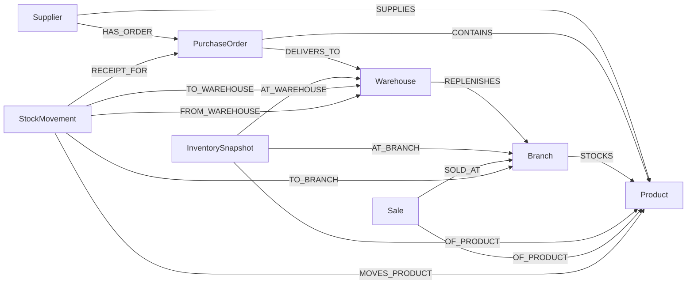
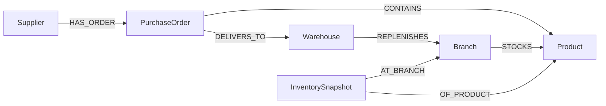

# GraphPilot — Graph Schema

> Companion to `GraphPilot_MVP_Scope.md`. This document defines the FalkorDB graph model: node labels, properties, relationship types and directions, the core investigation path, data-integrity rules, and evidence conventions.

**Status:** Planning · **Graph database:** FalkorDB · **Data:** Synthetic

---

## 1. Design Principle

FalkorDB is the primary reasoning and relationship-traversal layer. The graph represents real operational connections (who supplies what, which order delivers where, which warehouse feeds which branch), not just a visualization layer.

**Graph-necessity test.** The primary demo conclusion must not be reproducible from a single table or dashboard filter. It requires joining a supplier-side event to branch-level exposure through several relationship hops: `Supplier → PurchaseOrder → Warehouse → Branch`, plus matching `Product` and inventory evidence. If a feature can be answered by one flat lookup, it does not belong in the graph-reasoning story.

**Division of labour** (same as the scope document): Cypher retrieves nodes, relationships and paths. Python computes derived values such as days of cover. The LLM explains from the retrieved evidence only.

---

## 2. Schema Overview



---

## 3. Node Labels and Properties

Dates are ISO-8601 strings (`YYYY-MM-DD`). Each label has its own unique ID property. Any property marked *nullable* may be absent, and absence has a defined meaning (see §6 and §8).

### Supplier
| Property | Type | Notes |
|---|---|---|
| `supplier_id` | string, unique | e.g. `SUP-003` |
| `name` | string | |
| `lead_time_days` | integer | Typical lead time across products |
| `reliability_score` | float 0–1 | **Synthetic** historical indicator. Shown as context only; never used as evidence of cause and not an input to risk classification |

### Product
| Property | Type | Notes |
|---|---|---|
| `product_id` | string, unique | e.g. `PRD-101` |
| `name` | string | |
| `category` | string | |

> `reorder_level` moved to the `STOCKS` relationship (§4) because reorder targets differ by branch.

### PurchaseOrder
| Property | Type | Notes |
|---|---|---|
| `po_id` | string, unique | e.g. `PO-1042` |
| `order_date` | date | |
| `expected_date` | date | Originally promised delivery date |
| `revised_expected_date` | date, *nullable* | Supplier-communicated new ETA, if any |
| `actual_delivery_date` | date, *nullable* | Set only when goods are received |
| `status` | enum | Lifecycle only: `open`, `partially_received`, `received`, `cancelled` |
| `delay_reason` | string, *nullable* | Recorded reason, if any |

> `delayed` is **not** a stored status. It is derived (§6) so that a partially received order can also be late, and so missing data is never mistaken for a confirmed delay.

### Warehouse
| Property | Type | Notes |
|---|---|---|
| `warehouse_id` | string, unique | e.g. `WH-01` |
| `name` | string | |

### Branch
| Property | Type | Notes |
|---|---|---|
| `branch_id` | string, unique | e.g. `BR-01` |
| `name` | string | |
| `city` | string | |

### InventorySnapshot
| Property | Type | Notes |
|---|---|---|
| `snapshot_id` | string, unique | e.g. `SNP-WH01-PRD101-20261015` |
| `snapshot_date` | date | |
| `stock_on_hand` | integer ≥ 0 | |

Each snapshot belongs to **exactly one product** and **exactly one location** (a branch *or* a warehouse). The latest snapshot on or before `as_of_date` is the current position; earlier snapshots give trend context.

### Sale
| Property | Type | Notes |
|---|---|---|
| `sale_id` | string, unique | e.g. `SAL-BR01-PRD101-20260928` |
| `sale_date` | date | |
| `quantity` | integer ≥ 0 | |

MVP granularity: one `Sale` node per branch, product and day (a daily aggregate), keeping the dataset small and hand-verifiable.

### StockMovement *(supporting evidence; P1)*
| Property | Type | Notes |
|---|---|---|
| `movement_id` | string, unique | e.g. `MOV-0001` |
| `movement_date` | date | |
| `movement_type` | enum | MVP uses `receipt` and `dispatch`. `transfer` and `adjustment` are reserved for later phases |
| `quantity` | integer > 0 | |

---

## 4. Relationship Types

Direction is fixed and must not be reversed in seed data or queries.

| Relationship | Direction | Properties | Cardinality / rule |
|---|---|---|---|
| `SUPPLIES` | `(Supplier)-[:SUPPLIES]->(Product)` | none | A product may have several suppliers (enables alternate-supplier recommendations) |
| `HAS_ORDER` | `(Supplier)-[:HAS_ORDER]->(PurchaseOrder)` | none | Every PO has **exactly one** supplier |
| `CONTAINS` | `(PurchaseOrder)-[:CONTAINS]->(Product)` | `ordered_qty`, `received_qty` | A PO has one or more product lines |
| `DELIVERS_TO` | `(PurchaseOrder)-[:DELIVERS_TO]->(Warehouse)` | none | Every PO has **exactly one** destination warehouse |
| `REPLENISHES` | `(Warehouse)-[:REPLENISHES]->(Branch)` | none | Which warehouse feeds which branch |
| `STOCKS` | `(Branch)-[:STOCKS]->(Product)` | `reorder_level` | Branch carries the product; reorder target is branch-specific |
| `OF_PRODUCT` | `(InventorySnapshot)-[:OF_PRODUCT]->(Product)`, `(Sale)-[:OF_PRODUCT]->(Product)` | none | Exactly one product per record |
| `AT_BRANCH` | `(InventorySnapshot)-[:AT_BRANCH]->(Branch)` | none | Exactly one of `AT_BRANCH` / `AT_WAREHOUSE` per snapshot |
| `AT_WAREHOUSE` | `(InventorySnapshot)-[:AT_WAREHOUSE]->(Warehouse)` | none | See above |
| `SOLD_AT` | `(Sale)-[:SOLD_AT]->(Branch)` | none | Exactly one branch per sale |
| `MOVES_PRODUCT` | `(StockMovement)-[:MOVES_PRODUCT]->(Product)` | none | |
| `RECEIPT_FOR` | `(StockMovement)-[:RECEIPT_FOR]->(PurchaseOrder)` | none | `receipt` movements only |
| `TO_WAREHOUSE` | `(StockMovement)-[:TO_WAREHOUSE]->(Warehouse)` | none | `receipt` movements |
| `FROM_WAREHOUSE` | `(StockMovement)-[:FROM_WAREHOUSE]->(Warehouse)` | none | `dispatch` movements |
| `TO_BRANCH` | `(StockMovement)-[:TO_BRANCH]->(Branch)` | none | `dispatch` movements |

**Why `ordered_qty` and `received_qty` live on `CONTAINS`.** Without quantities the graph can show that an order *touches* a product but not how much is outstanding. Outstanding quantity is `ordered_qty − received_qty`.

---

## 5. Core Investigation Path

### 5.1 Original path and the problem with it

The original path was `Supplier → PurchaseOrder → Product → Branch → InventorySnapshot`. Taken alone it links a PO to every branch that merely stocks the product, even branches served by a different warehouse. That would be exactly the "causation from connectivity alone" the integrity rules forbid.

### 5.2 Refined path



A branch is **structurally exposed** to a PO only when **all** of these hold:

1. The PO has a `CONTAINS` line for product *P*.
2. The PO `DELIVERS_TO` warehouse *W*.
3. *W* `REPLENISHES` branch *B*.
4. *B* `STOCKS` the **same** product *P* (the same node, not a name match).

The warehouse is therefore part of the MVP's core path. It is a routing node, not an extra feature. Warehouse-to-warehouse *transfers* stay deferred (§9).

Structural exposure means "a dependency path exists." It is **not** evidence of cause. Risk and causal wording additionally require the date and quantity evidence defined in the scope document (§9.3 and §9.4).

### 5.3 Reverse path (symptom → cause)

`Branch + Product → (REPLENISHES, reversed) Warehouse → (DELIVERS_TO, reversed) PurchaseOrder → (HAS_ORDER, reversed) Supplier`, restricted to POs whose `CONTAINS` line includes that product.

### 5.4 Illustrative pattern (concept only; validate against FalkorDB during setup)

```cypher
MATCH (s:Supplier {supplier_id: $supplier_id})-[:HAS_ORDER]->(po:PurchaseOrder)
      -[c:CONTAINS]->(p:Product),
      (po)-[:DELIVERS_TO]->(w:Warehouse)-[:REPLENISHES]->(b:Branch)-[st:STOCKS]->(p)
WHERE po.status IN ['open', 'partially_received']
RETURN s, po, c, p, w, b, st
```

Reusing the variable `p` in both clauses enforces the same-product join. Snapshot and sales retrieval run as **separate** queries to avoid row multiplication.

---

## 6. Derived Values (Not Stored in the Graph)

Python computes these at investigation time, relative to a fixed `as_of_date`, so the graph holds only recorded facts.

**`effective_eta`** = `revised_expected_date` if present, otherwise `expected_date`.

| `delay_state` | Rule | Meaning |
|---|---|---|
| `CONFIRMED_DELAY` | Not received and `revised_expected_date > expected_date`; or `actual_delivery_date > expected_date` | A record evidences the delay. Delay days = difference in dates |
| `OVERDUE_UNCONFIRMED` | Not received, `as_of_date > expected_date`, no revised date | Late, but no supplier confirmation or ETA. The agent must not claim a confirmed delay and cannot compute exposure without an explicit assumed ETA |
| `ON_TRACK` | Not received and `as_of_date ≤ effective_eta` | No delay evidenced |
| `DELIVERED_ON_TIME` | Received and `actual_delivery_date ≤ expected_date` | |
| `DATA_GAP` | `status = received` but `actual_delivery_date` missing, or other inconsistency | A data-quality finding, **not** a delay |

Other derived values: `avg_daily_demand`, `days_of_cover`, `projected_stockout_date`, `exposure_days`, `estimated_unmet_units`, risk level (`AT_RISK` / `WATCH` / `OK`). Formulas are in the scope document (§9.2 and §9.3).

---

## 7. Graph Query Responsibilities

Each responsibility maps to a read-only, parameterised query template (IDs match the scope document). Every template returns the node IDs and relationship tuples needed to build the evidence path.

| Responsibility | Template | Returns |
|---|---|---|
| Find products connected to a supplier | `supplier_products` (new, T9) | Supplier, `SUPPLIES` edges, products |
| Trace open or late purchase orders | `disruption_lookup` (T1) | POs, lines (`ordered_qty`, `received_qty`), dates, destination warehouse. Python assigns `delay_state` |
| Identify branches exposed to affected products (§5.2 rules) | `downstream_impact` (T2) | Warehouse, branches, `STOCKS` edges |
| Retrieve inventory snapshots | `inventory_snapshot` (T3) | Latest snapshot per product and location, plus recent history |
| Retrieve sales evidence | `demand_by_branch` (T4) | Trailing 28-day sales aggregate per branch and product |
| Check other inbound supply | `alternative_inbound` (T5) | Other open POs for the same product and warehouse |
| Find rebalancing or alternate sources | `surplus_candidates` (T6), `alternate_suppliers` (T7) | Other locations holding the product; other suppliers via `SUPPLIES` |
| Trace upstream from a symptom | `upstream_trace` (T8) | Branch → warehouse → inbound POs → supplier |
| Return the relationship path | All templates | Ordered edges as `(from_id, relationship, to_id)` |

---

## 8. Data Integrity Rules

Rules are enforced by the seed script (fail the load on violation) and covered by unit tests.

**Identity and duplication**
- Every node has a stable, human-readable ID in its own ID property (§3).
- Seed idempotently: loading twice must not create duplicate nodes or edges. Create an index on each ID property, and optionally uniqueness constraints.
- At most one `InventorySnapshot` per product, location and date. At most one `Sale` per branch, product and day.

**Dates and values**
- All dates are ISO-8601 strings. Date arithmetic happens in Python.
- `order_date ≤ expected_date`. `revised_expected_date`, when present, is ≥ `order_date`. `actual_delivery_date`, when present, is ≥ `order_date`.
- Quantities are non-negative integers (`quantity` on `StockMovement` is > 0). Enumerated fields accept only the values in §3.

**Purchase-order consistency**
- `0 ≤ received_qty ≤ ordered_qty` on every `CONTAINS` line.
- `received` ⇒ all lines fully received and `actual_delivery_date` present. If the date is missing, flag `DATA_GAP`; do not infer a delay.
- `partially_received` ⇒ at least one line with `0 < received_qty < ordered_qty` or a mix of received and unreceived lines.
- Every PO has exactly one supplier, exactly one destination warehouse, and at least one product line.

**Referential rules**
- Every `InventorySnapshot` has exactly one product and exactly one location.
- Every `Sale` has exactly one product and one branch.
- Every `STOCKS` edge references an existing branch and product.

**Missing information vs. confirmed delay**
- A null `revised_expected_date` or `actual_delivery_date` is **missing information**, not a delay.
- A delay is confirmed only by a record (§6, `CONFIRMED_DELAY`). Past-due, unconfirmed orders are reported as `OVERDUE_UNCONFIRMED`.

**Causation and evidence**
- Never infer a causal relationship from connectivity alone (§5.2).
- "No matching record found" is a valid, labelled finding. It does not prove something does not exist.
- Every investigation conclusion carries source record identifiers (§10).
- `reliability_score` is synthetic context and is never cited as a cause.

---

## 9. MVP Simplification

Build one principal investigation path first (§5.2), then expand.

| Phase | Scope |
|---|---|
| **Core (P0)** | `Supplier`, `Product`, `PurchaseOrder`, `Warehouse`, `Branch`, `InventorySnapshot`, `Sale`; relationships `SUPPLIES`, `HAS_ORDER`, `CONTAINS`, `DELIVERS_TO`, `REPLENISHES`, `STOCKS`, `OF_PRODUCT`, `AT_BRANCH`, `AT_WAREHOUSE`, `SOLD_AT`. Warehouse snapshots are seeded only for the demo products |
| **Supporting (P1)** | `StockMovement` (`receipt` and `dispatch` only) to corroborate that no receipt exists for a late order |
| **Deferred** | Warehouse-to-warehouse transfer *movements*, `adjustment` movements, multi-tier suppliers, bill-of-materials (`COMPONENT_OF`) dependencies |

Why warehouse is in the core: a PO delivers to a warehouse, not a branch. Dropping it would force a connectivity-only path.

Why `AT_WAREHOUSE` snapshots are in the core for demo products: branch stock alone cannot show whether the warehouse has buffer stock. Without a warehouse snapshot, the agent may only report a *partially supported* finding with the assumption "warehouse buffer stock is not modelled" stated explicitly.

---

## 10. Evidence Referencing Convention

Evidence items use the same shape as the scope document's API (§11).

- **Node evidence:** `entity_id` is the node's ID value (`PO-1042`), with `label` and the relevant properties.
- **Relationship evidence:** identified by the tuple `(from_id, relationship, to_id)` plus any relationship properties (e.g. `ordered_qty`, `received_qty`).
- **Aggregate evidence:** `kind: aggregate` with `query_id`, `record_count`, and the underlying record IDs where practical. Zero rows is a valid aggregate.
- **Path evidence:** an ordered list of relationship tuples, as in `evidence_paths`.

---

## 11. Example Instance — Primary Demo Scenario

IDs and dates match the scope document. Branch snapshot values are intentionally omitted (see unresolved decision 3).

**Nodes**

| Label | Key properties |
|---|---|
| `Supplier` | `supplier_id: SUP-003`, `name: Apex Components Ltd`, `lead_time_days: 22`, `reliability_score: 0.72` (synthetic) |
| `Supplier` | `supplier_id: SUP-005`, `lead_time_days: 9` |
| `PurchaseOrder` | `po_id: PO-1042`, `order_date: 2026-09-20`, `expected_date: 2026-10-12`, `revised_expected_date: 2026-10-26`, `actual_delivery_date: null`, `status: open`, `delay_reason: null` |
| `Product` | `PRD-101` (USB-C Fast Charger 65W), `PRD-102` (Wireless Earbuds) |
| `Warehouse` | `WH-01`, `WH-02` |
| `Branch` | `BR-01`, `BR-02`, `BR-03` (served by WH-01); `BR-04`, `BR-05` (served by WH-02) |
| `InventorySnapshot` | `snapshot_id: SNP-WH01-PRD101-20261015`, `snapshot_date: 2026-10-15`, `stock_on_hand: 420` |

**Relationships**

```
(SUP-003)-[:HAS_ORDER]->(PO-1042)
(SUP-003)-[:SUPPLIES]->(PRD-101), (SUP-003)-[:SUPPLIES]->(PRD-102)
(SUP-005)-[:SUPPLIES]->(PRD-101)
(PO-1042)-[:CONTAINS {ordered_qty: 800, received_qty: 0}]->(PRD-101)
(PO-1042)-[:CONTAINS {ordered_qty: 600, received_qty: 0}]->(PRD-102)
(PO-1042)-[:DELIVERS_TO]->(WH-01)
(WH-01)-[:REPLENISHES]->(BR-01), (BR-02), (BR-03)
(BR-01)-[:STOCKS]->(PRD-101)
(SNP-WH01-PRD101-20261015)-[:OF_PRODUCT]->(PRD-101)
(SNP-WH01-PRD101-20261015)-[:AT_WAREHOUSE]->(WH-01)
```

**Derived at `as_of_date = 2026-10-15`:** `delay_state = CONFIRMED_DELAY` (revised ETA 2026-10-26 is 14 days after `expected_date` 2026-10-12). `lead_time_days: 22` is consistent with `order_date` 2026-09-20 → `expected_date` 2026-10-12.

---

## 12. Alignment with `GraphPilot_MVP_Scope.md`

The scope document predates this schema. These changes must be applied there so the two stay consistent.

| Scope document (§8) | This schema | Action |
|---|---|---|
| Generic `id` property on every node | Per-label IDs (`supplier_id`, `po_id`, …) | Adopt per-label IDs. API `entity_id` fields are unchanged |
| `InventoryRecord`, `HOLDS`, `OF_PRODUCT` | `InventorySnapshot`, `AT_WAREHOUSE` / `AT_BRANCH`, `OF_PRODUCT` | Rename; branch-level snapshots now allowed |
| `SalesRecord` | `Sale` | Rename |
| `PLACED_WITH` (PO → Supplier) | `HAS_ORDER` (Supplier → PO) | Adopt this schema's direction, which matches your original outline |
| `PurchaseOrder.status = DELAYED`, stored `delay_days` | Lifecycle `status` + derived `delay_state`; `revised_expected_date` added | Update the scope's PO properties and risk wording |
| `FULFILS` | `RECEIPT_FOR` | Rename |
| Supplier `SUPPLIES` carried `lead_time_days`, `is_primary` | `lead_time_days` on `Supplier`; no `is_primary` | Alternate suppliers are any other `SUPPLIES` source (see decision 4) |
| Product-level `reorder_point` on inventory record | `reorder_level` on `STOCKS` | Update scope |
| Branch stock not modelled | Branch snapshots modelled | Update exposure rules (decision 3) |
