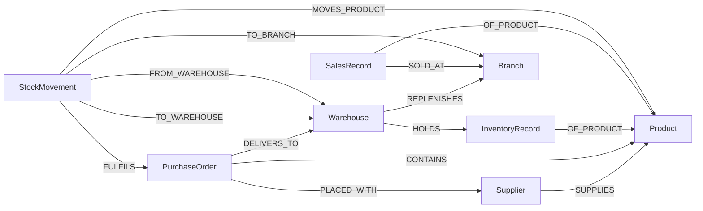
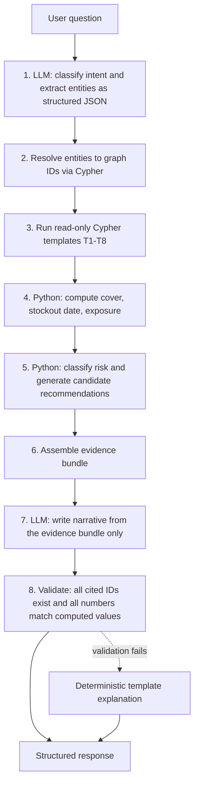

# GraphPilot — MVP Scope

> **GraphPilot** is an explainable AI supply-chain investigation agent powered by FalkorDB. It traces how a supplier or purchase-order disruption propagates through a connected supply-chain graph, identifies at-risk products and branches, and recommends evidence-backed recovery actions.

**Document status:** Planning (pre-implementation) · **Team size:** 2 · **Data:** Synthetic

---

## 1. Project Overview

GraphPilot helps businesses investigate inventory disruptions, discover connected operational risks, and identify evidence-based recovery actions. Every conclusion is backed by retrieved graph records and a traceable relationship path that the user can inspect.

**Core design principle: _Cypher retrieves, Python computes, the LLM explains._**

| Layer | Responsibility | Never does |
|---|---|---|
| FalkorDB / Cypher | Multi-hop traversal and evidence retrieval | Arithmetic-heavy business logic |
| Python (FastAPI) | Deterministic calculations, risk classification, recommendation rules, validation | Free-form explanation |
| LLM | Question understanding, template selection, narrative explanation from an evidence bundle | Computing numbers, inventing records, writing unvalidated queries |

This split keeps numbers reproducible, makes explanations auditable, and is realistic for a two-person beginner team.

---

## 2. Problem Statement

Businesses manage suppliers, purchase orders, inventory, sales, and warehouse movements across disconnected systems. A delay at one supplier may affect several products, warehouses, and branches, but the downstream impact is slow to trace manually.

Traditional dashboards show *which* items are running low. They rarely explain *why*, or which other entities share the same upstream dependency.

---

## 3. Proposed Solution

GraphPilot models the supply chain as a graph in FalkorDB. Given a natural-language question, the agent:

1. Interprets the question and resolves named entities to graph IDs.
2. Runs validated, read-only, parameterised Cypher templates to traverse relationships.
3. Computes days of cover, projected stockout dates, and exposure in Python.
4. Classifies risk with transparent rules.
5. Returns a structured investigation: root-cause statement, affected entities, evidence paths, calculated estimates, assumptions, and recommended next steps.

### Why a graph database is essential

The key questions are relationship traversals, not row lookups:

- **Downstream:** `Supplier → PurchaseOrder → Product → Warehouse → Branch`
- **Upstream:** `Branch ← Warehouse ← PurchaseOrder → Supplier`

A user who asks about one product at one branch can discover that sibling branches and other products share the same delayed purchase order. This is the "hidden disruption" discovery GraphPilot demonstrates.

---

## 4. Target Users

- Supply-chain and procurement managers
- Inventory and warehouse managers
- Operations leaders responsible for multiple branches

---

## 5. Primary Demo Scenario

All examples in this document use this scenario. Reference date (`as_of_date`) is fixed in the seed data (**2026-10-15**) so demos are reproducible and do not depend on the system clock.

**Primary question (cause → impact):**
> "Purchase order PO-1042 from Apex Components is delayed. Which products and branches are at risk, and what should we do?"

**Secondary question (symptom → cause):**
> "Why is PRD-101 at risk at North Branch 1?"

### Seeded scenario facts (synthetic)

| Entity | Key facts |
|---|---|
| `SUP-003` Apex Components Ltd | Primary supplier of PRD-101 and PRD-102 |
| `PO-1042` | Placed with SUP-003. Status `DELAYED`. Original expected 2026-10-12, revised 2026-10-26 (**14 days late**). Delivers to WH-01. Contains PRD-101 (ordered 800, received 0) and PRD-102 (ordered 600, received 0). `delay_reason` not recorded. |
| `PRD-101` USB-C Fast Charger 65W | WH-01 on hand **420**. WH-02 on hand **900**. No other open PO delivers it to WH-01. |
| `PRD-102` Wireless Earbuds | WH-01 on hand 300. Low demand (**negative control**, not at risk). |
| `WH-01` | Replenishes BR-01, BR-02, BR-03. PRD-101 demand: 25 + 20 + 15 = **60 units/day**. |
| `WH-02` | Replenishes BR-04, BR-05. PRD-101 demand **30 units/day** (surplus candidate). |
| `SUP-005` | Alternate (non-primary) supplier of PRD-101, listed lead time 9 days. |

**Expected outcome:** PRD-101, WH-01, and BR-01/02/03 are flagged `AT_RISK`. PRD-102 is checked and correctly reported as **not at risk**, which shows the agent does not raise false alarms.

---

## 6. MVP Features

| # | Feature | Priority |
|---|---|---|
| 1 | Load synthetic supplier, product, purchase-order, inventory, sales, and stock-movement data from a seed script | **P0** |
| 2 | Model entities and relationships in FalkorDB (schema in §8) | **P0** |
| 3 | Accept natural-language investigation questions (two supported intents, §7) | **P0** |
| 4 | Execute validated, read-only, parameterised Cypher against FalkorDB (§10) | **P0** |
| 5 | Trace downstream impact of a supplier or purchase-order disruption | **P0** |
| 6 | Identify at-risk products and branches using inventory and demand evidence | **P0** |
| 7 | Return root-cause statement, affected entities, evidence paths, labelled findings, and recommendations | **P0** |
| 8 | Chat interface with an evidence panel and a graph-path view | **P0** |
| 9 | Deterministic fallback explanation when the LLM is unavailable or its output fails validation | **P1** |
| 10 | Upstream root-cause tracing (symptom → cause intent) | **P1** |
| 11 | Preserve investigation history | **P2** (only if time permits) |
| 12 | Component/bill-of-materials dependencies (`COMPONENT_OF`) for deeper hidden-risk discovery | **P2 stretch** (not in MVP schema) |

---

## 7. Supported Investigation Intents

The MVP supports exactly two intents plus a graceful fallback. Constraining intents is what makes the demo reliable.

| Intent | Starting point | Direction | Example |
|---|---|---|---|
| `disruption_impact` | Supplier or PO | Downstream | "What is affected by the PO-1042 delay?" |
| `risk_root_cause` | Product, warehouse, or branch | Upstream | "Why is PRD-101 at risk at BR-01?" |
| *(unsupported)* | Anything else | n/a | Returns `unsupported_question` with examples of supported questions |

If an entity name is ambiguous or not found, the agent returns `needs_clarification` rather than guessing.

---

## 8. Graph Model

### 8.1 Schema



### 8.2 Node labels and properties

All nodes have a unique, human-readable string `id`. IDs are the evidence handles used throughout the API.

| Label | ID pattern | Properties |
|---|---|---|
| `Supplier` | `SUP-003` | `id`, `name`, `country` |
| `Product` | `PRD-101` | `id`, `name`, `category` |
| `PurchaseOrder` | `PO-1042` | `id`, `status` (`OPEN` \| `DELAYED` \| `RECEIVED` \| `CANCELLED`), `order_date`, `original_expected_date`, `revised_expected_date`, `delay_days`, `delay_reason` (nullable) |
| `Warehouse` | `WH-01` | `id`, `name`, `region` |
| `Branch` | `BR-01` | `id`, `name`, `region` |
| `InventoryRecord` | `INV-WH01-PRD101` | `id`, `on_hand_qty`, `reorder_point`, `as_of_date` |
| `SalesRecord` | `SAL-BR01-PRD101-20260928` | `id`, `date`, `quantity` |
| `StockMovement` | `MOV-0001` | `id`, `date`, `movement_type` (`RECEIPT` \| `TRANSFER_OUT`), `quantity` |

**Conventions**

- Dates are ISO-8601 strings (`YYYY-MM-DD`). Date arithmetic is done in Python, not Cypher.
- `delay_days = revised_expected_date − original_expected_date`. The seed script must validate this.
- `delay_reason` is nullable. If it is null, the agent must say the reason is **not recorded** and must not speculate.

### 8.3 Relationships (direction is fixed)

| Relationship | Direction | Properties | Meaning |
|---|---|---|---|
| `SUPPLIES` | `(Supplier)-[:SUPPLIES]->(Product)` | `lead_time_days`, `is_primary` (bool) | Supplier can supply this product |
| `PLACED_WITH` | `(PurchaseOrder)-[:PLACED_WITH]->(Supplier)` | none | PO was placed with this supplier |
| `CONTAINS` | `(PurchaseOrder)-[:CONTAINS]->(Product)` | `ordered_qty`, `received_qty` | PO line for a product |
| `DELIVERS_TO` | `(PurchaseOrder)-[:DELIVERS_TO]->(Warehouse)` | none | Destination warehouse |
| `HOLDS` | `(Warehouse)-[:HOLDS]->(InventoryRecord)` | none | Warehouse owns this stock record |
| `OF_PRODUCT` | `(InventoryRecord\|SalesRecord\|…)-[:OF_PRODUCT]->(Product)` | none | Record relates to a product |
| `REPLENISHES` | `(Warehouse)-[:REPLENISHES]->(Branch)` | none | Warehouse is the stock source for the branch |
| `SOLD_AT` | `(SalesRecord)-[:SOLD_AT]->(Branch)` | none | Where the sale happened |
| `MOVES_PRODUCT` | `(StockMovement)-[:MOVES_PRODUCT]->(Product)` | none | Product moved |
| `FULFILS` | `(StockMovement)-[:FULFILS]->(PurchaseOrder)` | none | `RECEIPT` movements only |
| `TO_WAREHOUSE` | `(StockMovement)-[:TO_WAREHOUSE]->(Warehouse)` | none | `RECEIPT` movements only |
| `FROM_WAREHOUSE` | `(StockMovement)-[:FROM_WAREHOUSE]->(Warehouse)` | none | `TRANSFER_OUT` movements only |
| `TO_BRANCH` | `(StockMovement)-[:TO_BRANCH]->(Branch)` | none | `TRANSFER_OUT` movements only |

### 8.4 Modelling decisions

| Decision | Rationale |
|---|---|
| Inventory is held **at warehouses only**. Branches are exposed through `REPLENISHES` and their own sales demand. | Keeps the dataset small. Branch risk is derived from its source warehouse's risk and its share of demand. |
| `InventoryRecord` is a node, not a relationship property. | Gives each stock reading a citable evidence ID. |
| PO lines are modelled as `CONTAINS` relationship properties, not a separate `POLine` node. | Fewer node types for the MVP. Revisit only if a PO needs per-line status. |
| Each node's `id` is indexed. | Fast entity resolution. Optionally add uniqueness constraints. |
| `StockMovement` is **supporting evidence only**. | Used to corroborate that no receipt exists for a delayed PO. It is the first feature to cut if time is short. |

### 8.5 Seed data size (guideline)

Roughly 5 suppliers, 15 products, 10 POs, 2–3 warehouses, 5–6 branches, and 28 days of daily sales for the demo products. This is large enough for non-trivial traversals and small enough to hand-verify.

---

## 9. Investigation Workflow



### 9.1 Query templates (primary path)

Parameterised, read-only Cypher templates are the **primary** retrieval mechanism. LLM-written Cypher is an optional, strictly validated fallback (see §10 and §16).

| ID | Template | Purpose |
|---|---|---|
| T1 | `disruption_lookup` | Delayed POs for a supplier or PO ID, with lines and destination warehouse |
| T2 | `downstream_impact` | PO line → warehouse → replenished branches |
| T3 | `inventory_snapshot` | Inventory records per warehouse and product |
| T4 | `demand_by_branch` | Trailing 28-day sales per branch and product (aggregate) |
| T5 | `alternative_inbound` | Other open POs for the same product and warehouse |
| T6 | `surplus_candidates` | Other warehouses holding the product, with their branch demand |
| T7 | `alternate_suppliers` | Other suppliers of the product (`SUPPLIES`) with lead times |
| T8 | `upstream_trace` | Branch + product → warehouse → inbound POs → supplier |

**Illustrative pattern for T1/T2 (concept only; must be validated against FalkorDB's openCypher support during setup):**

```cypher
MATCH (po:PurchaseOrder {id: $po_id})-[:PLACED_WITH]->(s:Supplier),
      (po)-[c:CONTAINS]->(p:Product),
      (po)-[:DELIVERS_TO]->(w:Warehouse)
RETURN po, s, p, c, w
```

Branch expansion and inventory retrieval run as **separate** queries to avoid row multiplication from multiple optional matches.

### 9.2 Deterministic calculations (Python)

| Metric | Formula |
|---|---|
| `avg_daily_demand` (per branch, product) | `sum(SalesRecord.quantity over trailing 28 days) / 28` |
| Warehouse demand | Sum of `avg_daily_demand` over branches it `REPLENISHES` |
| `days_of_cover` | `on_hand_qty / warehouse_avg_daily_demand` |
| `projected_stockout_date` | `as_of_date + days_of_cover` |
| `exposure_days` | `max(0, revised_expected_date − projected_stockout_date)` |
| `estimated_unmet_units` | `exposure_days × avg_daily_demand` (per branch and in total) |
| `surplus_units` (other warehouse) | `on_hand_qty − (avg_daily_demand × safety_days)` |

### 9.3 Risk classification (transparent, configurable rules)

| Level | Rule |
|---|---|
| `AT_RISK` | `exposure_days > 0` (stock projected to run out before the delayed PO arrives) |
| `WATCH` | `exposure_days = 0` and projected stockout is within 5 days after `revised_expected_date` |
| `OK` | Otherwise |

Branch risk inherits the level of its source warehouse for that product. Results are ranked by `estimated_unmet_units`. The 5-day watch window is a configurable assumption (see §9.5).

### 9.4 Evidence labels

Every statement in a response carries exactly one label.

| Label | Definition | Example |
|---|---|---|
| **Verified fact** | Directly read from a retrieved graph record | "PO-1042 status is DELAYED; revised expected date is 2026-10-26." |
| **Calculated estimate** | Deterministic formula over verified facts and listed assumptions; shows formula and inputs | "Days of cover = 420 / 60 = 7.0." |
| **Assumption** | A configured parameter or modelling simplification not present in the data | "Demand continues at the trailing 28-day average." |
| **Recommendation** | A proposed action; always requires human approval; cites the findings it relies on | "Transfer 240 units of PRD-101 from WH-02 to WH-01." |

**Causal language rules**

- Use "supported by records" only when all three links exist in the retrieved data: (1) a delay record, (2) a product/warehouse linkage, and (3) inventory and demand figures showing a projected shortfall.
- The agent may state *that* PO-1042 is delayed and *that* this precedes a projected shortfall. It must **not** state *why* the supplier is delayed unless `delay_reason` is populated.
- "No matching record found in the dataset" is a valid verified negative. It must not be rephrased as "this does not exist."
- If evidence is incomplete, return `insufficient_evidence` and list what is missing.

### 9.5 Assumptions used in the demo (all configurable)

| ID | Assumption |
|---|---|
| A1 | Demand continues at the trailing 28-day average. |
| A2 | Safety-stock policy is 14 days of cover at a donor warehouse. |
| A3 | An inter-warehouse transfer takes 2 days. (Not in data.) |
| A4 | The alternate supplier's listed lead time holds and capacity is available. (Not in data.) |
| A5 | A warehouse serves its branches in proportion to demand, with no rationing. |

### 9.6 Recommendation rules (rule-based candidates, narrated by the LLM)

| Action type | Trigger | Supporting evidence |
|---|---|---|
| `INTER_WAREHOUSE_TRANSFER` | Another warehouse's `surplus_units` ≥ `estimated_unmet_units`, and transfer arrival < projected stockout (A3) | T6 results |
| `EXPEDITE_PO` | PO is `DELAYED` and `exposure_days > 0` | T1 results |
| `ORDER_FROM_ALTERNATE_SUPPLIER` | An alternate supplier exists and `as_of_date + lead_time_days < revised_expected_date` | T7 results (partial mitigation shown) |

Recommendations are ordered by expected reduction in `estimated_unmet_units`. GraphPilot **never creates or changes orders** (out of scope).

---

## 10. Query Safety

All Cypher, whether from templates or any LLM-generated fallback, passes the same validator before execution.

- **Execution mode:** read-only (FalkorDB's read-only query command, via the Python client's read-only method; confirm availability in the pinned client version).
- **Single statement only.** No semicolon-chained statements.
- **Clause allowlist:** `MATCH`, `OPTIONAL MATCH`, `WHERE`, `WITH`, `RETURN`, `ORDER BY`, `LIMIT`, `UNWIND`.
- **Blocked keywords:** `CREATE`, `MERGE`, `SET`, `DELETE`, `REMOVE`, `DROP`, `CALL`, `LOAD CSV`, `FOREACH`.
- **Schema allowlist:** only the labels, relationship types, and properties in §8.
- **Parameters** for all user-derived values (no string interpolation of user text).
- **Limits:** enforced `LIMIT` and a query timeout.
- **Credentials:** the app uses a connection with no administrative need. The LLM key lives in an environment variable.
- **LLM output** is treated as untrusted input: structured-JSON parsing, entity IDs checked against the graph, narrative checked against the evidence bundle.

---

## 11. API Contract

| Method | Endpoint | Priority | Description |
|---|---|---|---|
| `GET` | `/api/health` | P0 | App, FalkorDB, and LLM configuration status |
| `POST` | `/api/investigations` | P0 | Run an investigation synchronously and return the full result |
| `GET` | `/api/investigations/{investigation_id}` | P2 | Retrieve a stored investigation |
| `GET` | `/api/investigations` | P2 | List past investigations (history) |

Graph seeding runs as a documented CLI script (`seed_graph`), not an HTTP endpoint, so no write path is exposed over the API.

**Request**

```json
{ "question": "Purchase order PO-1042 from Apex Components is delayed. Which products and branches are at risk, and what should we do?" }
```

**Response `status` values:** `completed`, `needs_clarification`, `insufficient_evidence`, `unsupported_question`, `error`.

**Example response (illustrative excerpt for the primary demo; values are consistent with §5 and §9)**

```json
{
  "investigation_id": "inv-20261015-0001",
  "status": "completed",
  "intent": "disruption_impact",
  "question": "Purchase order PO-1042 from Apex Components is delayed. Which products and branches are at risk, and what should we do?",
  "as_of_date": "2026-10-15",
  "summary": "The 14-day delay of PO-1042 is projected to cause a PRD-101 stockout at WH-01 on 2026-10-22, four days before the revised arrival date, exposing BR-01, BR-02 and BR-03 to an estimated 240 units of unmet demand.",
  "root_cause": {
    "statement": "The delay of PO-1042 (SUP-003) is the supported driver of the projected PRD-101 shortfall at WH-01. The reason for the supplier delay is not recorded.",
    "support_level": "supported",
    "supporting_finding_ids": ["F1", "F2", "F3", "F4", "C1", "C2", "C3"]
  },
  "verified_facts": [
    {
      "finding_id": "F1",
      "statement": "PO-1042, placed with SUP-003, has status DELAYED. Original expected date 2026-10-12, revised expected date 2026-10-26 (14 days). delay_reason is not recorded.",
      "evidence_ids": ["E1"]
    },
    {
      "finding_id": "F2",
      "statement": "PO-1042 contains PRD-101 (ordered 800, received 0) and PRD-102 (ordered 600, received 0), and delivers to WH-01.",
      "evidence_ids": ["E2", "E3"]
    },
    {
      "finding_id": "F3",
      "statement": "WH-01 holds 420 units of PRD-101 as of 2026-10-15 and replenishes BR-01, BR-02 and BR-03.",
      "evidence_ids": ["E4", "E5"]
    },
    {
      "finding_id": "F4",
      "statement": "No other open purchase order delivering PRD-101 to WH-01 was found in the dataset.",
      "evidence_ids": ["E6"]
    },
    {
      "finding_id": "F5",
      "statement": "WH-02 holds 900 units of PRD-101 as of 2026-10-15.",
      "evidence_ids": ["E7"]
    },
    {
      "finding_id": "F6",
      "statement": "SUP-005 is a non-primary supplier of PRD-101 with a listed lead time of 9 days.",
      "evidence_ids": ["E8"]
    }
  ],
  "calculated_estimates": [
    {
      "finding_id": "C1",
      "statement": "Trailing 28-day demand for PRD-101 across WH-01's branches is 60 units/day (BR-01: 25, BR-02: 20, BR-03: 15).",
      "formula": "sum(quantity, 28 days) / 28 per branch",
      "inputs": { "BR-01": 25, "BR-02": 20, "BR-03": 15 },
      "evidence_ids": ["E9"],
      "assumption_ids": ["A1"]
    },
    {
      "finding_id": "C2",
      "statement": "WH-01 has about 7.0 days of PRD-101 cover, giving a projected stockout on 2026-10-22.",
      "formula": "on_hand_qty / daily_demand = 420 / 60",
      "inputs": { "on_hand_qty": 420, "daily_demand": 60 },
      "evidence_ids": ["E4", "E9"],
      "assumption_ids": ["A1"]
    },
    {
      "finding_id": "C3",
      "statement": "Stock is projected to run out 4 days before PO-1042 arrives, leaving about 240 units of unmet demand (BR-01: 100, BR-02: 80, BR-03: 60).",
      "formula": "exposure_days x daily_demand = (2026-10-26 - 2026-10-22) x 60",
      "inputs": { "exposure_days": 4, "daily_demand": 60 },
      "evidence_ids": ["E1", "E4", "E9"],
      "assumption_ids": ["A1", "A5"]
    },
    {
      "finding_id": "C4",
      "statement": "WH-02 has about 480 units of PRD-101 above a 14-day safety cover.",
      "formula": "on_hand_qty - (daily_demand x safety_days) = 900 - (30 x 14)",
      "inputs": { "on_hand_qty": 900, "daily_demand": 30, "safety_days": 14 },
      "evidence_ids": ["E7", "E10"],
      "assumption_ids": ["A1", "A2"]
    },
    {
      "finding_id": "C5",
      "statement": "PRD-102 at WH-01 has about 25 days of cover (projected stockout 2026-11-09), after the revised PO arrival, so it is not at risk.",
      "formula": "300 / 12 = 25 days",
      "inputs": { "on_hand_qty": 300, "daily_demand": 12 },
      "evidence_ids": ["E11"],
      "assumption_ids": ["A1"]
    }
  ],
  "assumptions": [
    { "assumption_id": "A1", "statement": "Demand continues at the trailing 28-day average." },
    { "assumption_id": "A2", "statement": "A donor warehouse keeps 14 days of safety cover." },
    { "assumption_id": "A3", "statement": "An inter-warehouse transfer takes 2 days (not in data)." },
    { "assumption_id": "A4", "statement": "The alternate supplier's listed lead time holds and capacity is available (not in data)." },
    { "assumption_id": "A5", "statement": "WH-01 serves branches in proportion to demand with no rationing." }
  ],
  "affected_entities": [
    { "entity_id": "SUP-003", "type": "Supplier", "role": "disruption_source" },
    { "entity_id": "PO-1042", "type": "PurchaseOrder", "role": "delayed_order" },
    { "entity_id": "PRD-101", "type": "Product", "role": "at_risk_product", "risk_level": "AT_RISK", "estimated_unmet_units": 240 },
    { "entity_id": "WH-01", "type": "Warehouse", "role": "at_risk_location", "risk_level": "AT_RISK" },
    { "entity_id": "BR-01", "type": "Branch", "role": "at_risk_branch", "risk_level": "AT_RISK", "estimated_unmet_units": 100 },
    { "entity_id": "BR-02", "type": "Branch", "role": "at_risk_branch", "risk_level": "AT_RISK", "estimated_unmet_units": 80 },
    { "entity_id": "BR-03", "type": "Branch", "role": "at_risk_branch", "risk_level": "AT_RISK", "estimated_unmet_units": 60 },
    { "entity_id": "PRD-102", "type": "Product", "role": "checked_not_at_risk", "risk_level": "OK" }
  ],
  "evidence_paths": [
    {
      "path_id": "P1",
      "description": "Supplier to branch impact chain for PRD-101",
      "edges": [
        { "from": "PO-1042", "relationship": "PLACED_WITH", "to": "SUP-003" },
        { "from": "PO-1042", "relationship": "CONTAINS", "to": "PRD-101" },
        { "from": "PO-1042", "relationship": "DELIVERS_TO", "to": "WH-01" },
        { "from": "WH-01", "relationship": "HOLDS", "to": "INV-WH01-PRD101" },
        { "from": "INV-WH01-PRD101", "relationship": "OF_PRODUCT", "to": "PRD-101" },
        { "from": "WH-01", "relationship": "REPLENISHES", "to": "BR-01" },
        { "from": "WH-01", "relationship": "REPLENISHES", "to": "BR-02" },
        { "from": "WH-01", "relationship": "REPLENISHES", "to": "BR-03" }
      ],
      "evidence_ids": ["E1", "E2", "E3", "E4", "E5"]
    }
  ],
  "recommendations": [
    {
      "recommendation_id": "R1",
      "priority": 1,
      "action_type": "INTER_WAREHOUSE_TRANSFER",
      "statement": "Transfer at least 240 units of PRD-101 from WH-02 to WH-01. WH-02 would retain about 22 days of cover (660 / 30).",
      "supported_by": ["F5", "C3", "C4"],
      "assumption_ids": ["A2", "A3"],
      "expected_effect": "Covers the estimated 240-unit gap; arrival (about 2026-10-17) precedes the projected stockout (2026-10-22).",
      "requires_human_approval": true
    },
    {
      "recommendation_id": "R2",
      "priority": 2,
      "action_type": "EXPEDITE_PO",
      "statement": "Ask SUP-003 to expedite PO-1042, or at least its PRD-101 line, ahead of 2026-10-22.",
      "supported_by": ["F1", "C3"],
      "assumption_ids": [],
      "expected_effect": "Eliminates the exposure if delivery is achieved by the projected stockout date. Feasibility depends on the supplier.",
      "requires_human_approval": true
    },
    {
      "recommendation_id": "R3",
      "priority": 3,
      "action_type": "ORDER_FROM_ALTERNATE_SUPPLIER",
      "statement": "Contingency: an order placed today with SUP-005 (9-day lead time) would arrive about 2026-10-24, reducing exposure from 4 to 2 days (about 120 units).",
      "supported_by": ["F6", "C3"],
      "assumption_ids": ["A4"],
      "expected_effect": "Partial mitigation only.",
      "requires_human_approval": true
    }
  ],
  "queries_executed": [
    { "query_id": "Q1", "template": "disruption_lookup", "params": { "po_id": "PO-1042" }, "row_count": 2, "read_only": true },
    { "query_id": "Q2", "template": "downstream_impact", "params": { "po_id": "PO-1042" }, "row_count": 6, "read_only": true }
  ],
  "limitations": [
    "The cause of the supplier delay is not recorded for PO-1042.",
    "Estimates assume constant demand and no rationing (A1, A5).",
    "Transfer time and alternate-supplier capacity are assumptions, not data (A3, A4).",
    "Findings are based on synthetic data as of 2026-10-15."
  ]
}
```

*Excerpt note:* the full response also contains the `evidence` array (E1–E11) and all executed queries. Each evidence item has this shape:

```json
{ "evidence_id": "E1", "kind": "record", "entity_id": "PO-1042", "label": "PurchaseOrder",
  "properties": { "status": "DELAYED", "original_expected_date": "2026-10-12", "revised_expected_date": "2026-10-26", "delay_days": 14, "delay_reason": null },
  "query_id": "Q1" }
```

`kind` is `record` (a node or relationship from the graph) or `aggregate` (a computed result over records, such as the 28-day sales sum, with `record_count` and `query_id`). A "no matching records" result (E6) is an `aggregate` with `record_count: 0`.

**Response integrity rules (enforced by the validator)**

1. Every ID in `evidence_ids`, `supporting_finding_ids`, and `supported_by` must exist in the response.
2. Every number in the narrative must match a computed value.
3. Every entity ID must exist in the graph.
4. Every recommendation has `requires_human_approval: true`.

---

## 12. Frontend (React + Vite)

- **Chat panel:** question input, status, narrative summary, and recommendations.
- **Evidence panel:** verified facts, calculated estimates (with formulas), assumptions, and limitations, each linked to its evidence items.
- **Graph-path view:** renders **only** `evidence_paths` (a small focused subgraph, not the whole database). Nodes colored by label; at-risk nodes highlighted. Clicking a node or edge shows its evidence properties.
- **Example-question buttons** for the primary and secondary demo questions.
- *(P2)* Investigation history sidebar.

---

## 13. Out of Scope

- Live ERP integrations
- Real-time external logistics feeds
- Autonomous purchase-order creation or any write action on business data
- Production-grade forecasting models (the MVP uses a transparent trailing-average estimate)
- Enterprise authentication and deployment infrastructure
- Cost, pricing, or margin optimisation
- Multi-tenant data handling

---

## 14. Success Criteria

Criteria are testable against the seeded scenario.

| # | Criterion | How to verify |
|---|---|---|
| 1 | The primary demo question returns `status: completed` with PRD-101, WH-01, BR-01, BR-02 and BR-03 flagged `AT_RISK` | Scripted end-to-end test |
| 2 | PRD-102 is checked and reported as **not** at risk (no false positive) | Same test |
| 3 | Impact is traced across at least four entity types (Supplier, PO, Product/Warehouse, Branch) using multi-hop traversal in FalkorDB | Inspect `evidence_paths` and `queries_executed` |
| 4 | Every claimed cause and every number resolves to evidence items; no dangling IDs | Response validator test |
| 5 | Calculated values match hand-computed expectations (7.0 days, 2026-10-22, 4 days, 240 units) | Unit tests on the calculation module |
| 6 | The secondary question traces upstream from BR-01 to SUP-003 | Scripted test |
| 7 | Write or unsafe Cypher is rejected by the validator | Unit tests with blocked-clause cases |
| 8 | If the LLM fails or its output is invalid, a deterministic explanation is returned | Failure-injection test |
| 9 | A user can click through from a conclusion to its evidence in the UI | Manual demo check |
| 10 | A teammate can set up and run the project from the README | Fresh-clone walkthrough |

---

## 15. Technology Stack

| Layer | Choice |
|---|---|
| Graph database | FalkorDB |
| Backend | Python, FastAPI |
| Query language | Cypher (parameterised templates, validated) |
| Frontend | React, Vite |
| AI | One LLM API: structured intent extraction and constrained narrative generation |
| Data | Synthetic, generated by a seed script with predefined disruption scenarios |
| Collaboration | GitHub |

No additional databases, ML libraries, or message queues are planned.

---

## 16. Risks and Mitigations

| Risk | Mitigation |
|---|---|
| LLM-written Cypher is unreliable | Template-first retrieval; LLM only selects a template and fills parameters |
| LLM invents facts or numbers | The LLM sees only the evidence bundle; the validator checks IDs and numbers; deterministic fallback |
| FalkorDB's Cypher subset differs from expectations | Prototype every template against the real database in the first milestone |
| Demo fragility | Fixed `as_of_date`, seeded data, scripted end-to-end tests, example-question buttons |
| Scope creep | Anything marked P2 is cut first; no features outside §6 |

---

## 17. Suggested Build Order

1. **Data and graph:** schema, seed script, indexes, hand-verified T1–T8 templates in FalkorDB.
2. **Backend core:** calculation module, risk rules, recommendation rules, query validator, with unit tests.
3. **Agent layer:** intent extraction, entity resolution, evidence bundle, narrative generation, response validator, deterministic fallback.
4. **API and frontend:** `POST /api/investigations`, chat panel, evidence panel, graph-path view.
5. **Polish:** README, example questions, demo script, optional history (P2).

---

## 18. Core Differentiator

GraphPilot does not merely report that stock is low. It investigates how connected operational events create risk, discovers affected products and branches the user did not ask about, shows the relationship path behind each finding, separates verified facts from estimates and assumptions, and recommends a recovery action that a human can approve. Every claim is traceable to a record in the graph.
